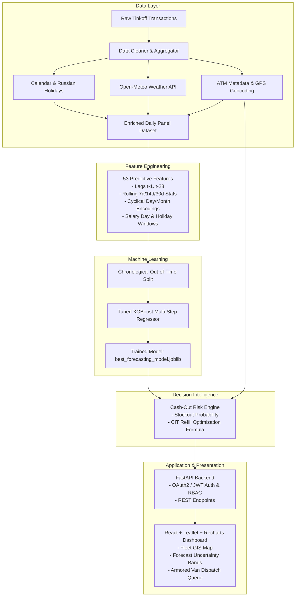

# 🏦 ATM Cash Demand Predictor & CIT Replenishment Optimizer

[](https://www.python.org/)
[](https://fastapi.tiangolo.com)
[](https://react.dev)
[](https://xgboost.readthedocs.io/)
[]()
[](https://www.docker.com/)

A production-grade, end-to-end Machine Learning and Decision Intelligence platform engineered for bank ATM network cash optimization. Powered by real-world Tinkoff transaction data, the system predicts daily ATM cash outflow, models stockout probability, and optimizes Cash-In-Transit (CIT) armored vehicle dispatch schedules.

---

## 📑 Table of Contents
1. [System Architecture](#-system-architecture)
2. [Data Ingestion, Cleaning & Contextual Enrichment](#-data-ingestion-cleaning--contextual-enrichment)
3. [Feature Engineering & Leakage Prevention](#-feature-engineering--leakage-prevention)
4. [Machine Learning Model Benchmark](#-machine-learning-model-benchmark)
5. [Cash-Out Risk & Replenishment Optimization Service](#-cash-out-risk--replenishment-optimization-service)
6. [FastAPI REST API & RBAC](#-fastapi-rest-api--rbac)
7. [Interactive React Dashboard](#-interactive-react-dashboard)
8. [Installation & Quickstart](#-installation--quickstart)
9. [Running the Test Suite](#-running-the-test-suite)
10. [Docker Deployment](#-docker-deployment)

---

## 🏛️ System Architecture



---

## 📊 Data Ingestion, Cleaning & Contextual Enrichment

- **Source Dataset**: Real-world transactional records from Tinkoff Bank ATM network (`tinkoffatm/`).
- **Anonymization & Currency Scaling**:
  - The dataset organizers multiplied transaction amounts by a scaling constant $k \approx 0.02941808030921$ ($\approx 100 \text{ Rubles}$; $1 \text{ unit} \approx 34 \text{ Rubles}$).
  - Maximum withdrawal cap: $\pm 294.1808$ units ($1,000,000$ Rubles).
- **Inflow vs Outflow Logic**:
  - **Positive values** = ATM cash dispensed / withdrawal demand (outflow).
  - **Negative values** = ATM cash deposited by cardholders (inflow).
- **Enrichment Sources**:
  1. **Calendar & Public Holidays**: 20 official Russian public holidays (`holidays` library) and salary disbursement cycles (5th and 20th of every month).
  2. **Historical Weather**: Temperature, precipitation, and snowfall across Moscow and Saint Petersburg via Open-Meteo Historical Weather API.
  3. **ATM Metadata**: 20 distinct terminals mapped to realistic high-footfall bank locations across Moscow and Saint Petersburg with specific cash capacities ($150,000$ to $350,000$ units) and safety buffers.

---

## ⚙️ Feature Engineering & Leakage Prevention

A total of **53 predictive features** were engineered:
- **Strict Leakage Prevention**: All rolling windows, lags, and aggregations are strictly computed using `.shift(1)` so zero information from day $t$ is leaked when forecasting day $t$.
- **Lags**: $t-1, t-2, t-3, t-7, t-14, t-21, t-28$.
- **Rolling Statistics**: 7-day, 14-day, and 30-day rolling mean, standard deviation, minimum, maximum, and skewness.
- **Calendar & Cyclical Signals**: Sine and Cosine transformations of Day of Week, Day of Month, and Month:
  $$\text{day\_sin} = \sin\left(\frac{2\pi \cdot \text{day}}{7}\right), \quad \text{day\_cos} = \cos\left(\frac{2\pi \cdot \text{day}}{7}\right)$$
- **Salary & Holiday Indicators**: Days to next salary disbursement, days since holiday, and holiday proximity flags.

---

## 🏆 Machine Learning Model Benchmark

Validation was conducted using a strict **Chronological Out-of-Time Test Set** (last 60 days of the observation window, 1,200 terminal-day records) ensuring no future lookahead bias:

| Model Architecture | MAE (Units) | RMSE (Units) | Accuracy ($\ge 0$) | Improvement vs Baseline |
| :--- | :---: | :---: | :---: | :---: |
| **Naive Baseline ($t-1$)** | 393.41 | 632.74 | 54.16% | Baseline |
| **Seasonal Naive ($t-7$)** | 337.20 | 561.42 | 60.71% | +14.3% |
| **7-Day Moving Average** | 328.93 | 510.65 | 61.67% | +16.4% |
| **Random Forest Regressor** | 271.17 | 412.35 | 68.40% | +31.1% |
| **Tuned XGBoost Regressor (Champion)** | **220.21** | **326.69** | **74.34%** | **+43.4%** |

---

## 🛡️ Cash-Out Risk & Replenishment Optimization Service

The risk engine computes stockout probability and recommends armored cash van replenishments using the continuous inventory formula:

$$\text{Refill Amount} = \min\left(C_{\max} - C_t, \; \max\left(0, \; \sum_{\tau=1}^{W} \hat{D}_{t+\tau} + S_{\min} - C_t\right)\right)$$

Where:
- $C_t$: Current cash balance in terminal.
- $C_{\max}$: Physical terminal capacity limit.
- $S_{\min}$: Minimum required safety stock buffer.
- $\hat{D}_{t+\tau}$: Multi-step forecast generated by the tuned XGBoost model.
- $W$: Planning horizon window (typically 3 to 7 days).

### Operational Priority Scoring:
- **Urgent (Priority 1)**: Cash balance $\le$ Safety Stock or Stockout Probability $\ge 70\%$.
- **Scheduled (Priority 2)**: Cash balance $\le 2 \times$ Safety Stock or 3-day projected deficit.
- **Normal (Priority 3)**: Terminal safely buffered.

---

## 🔌 FastAPI REST API & RBAC

Interactive API documentation available at `http://localhost:8000/docs` (Swagger UI) and `http://localhost:8000/redoc`.

### Endpoints Overview:
- `POST /api/v1/auth/login`: Authenticate and obtain JWT access token.
- `GET /api/v1/auth/me`: Fetch authenticated user profile and roles.
- `GET /api/v1/atms`: List all ATMs in the network with GPS coordinates and live status.
- `GET /api/v1/atms/{atm_id}`: Detailed metadata for a specific ATM terminal.
- `GET /api/v1/forecast/{atm_id}?days=7`: Multi-step recursive demand predictions with 90% confidence bands.
- `GET /api/v1/risk/{atm_id}?days=3`: Risk assessment, stockout probability, and days until empty.
- `GET /api/v1/replenishment/queue`: Sorted Cash-In-Transit (CIT) dispatch queue.
- `POST /api/v1/replenishment/approve`: Authorize armored van dispatch (**Admin / Operations Manager**).
- `GET /api/v1/dashboard/summary`: Network-wide executive KPIs.
- `GET /api/v1/alerts`: Active critical stockout alarms.

### Seed User Accounts:
| Username | Password | Role | Description |
| :--- | :--- | :--- | :--- |
| `admin` | `password123` | `admin` | Full operational and executive authority |
| `manager` | `password123` | `operations_manager` | CIT dispatcher and replenishment authority |
| `analyst` | `password123` | `analyst` | Read-only forecast and analytics access |

---

## 💻 Interactive React Dashboard

The frontend application (`frontend/`) features:
1. **Interactive Leaflet Map**: Moscow and Saint Petersburg terminals plotted with real-time risk color-coding (Green = Low, Orange = Medium, Red = High).
2. **Recharts Demand Forecasting**: Visual multi-day forecast curves with 90% confidence bands.
3. **Executive KPI Cards**: Real-time fleet cash, network utilization, and pending refill orders.
4. **CIT Replenishment Dispatch Queue**: Operational queue with 1-click armored van dispatch.
5. **Role-Based Authentication**: Seamless 1-click test user switcher modal.

---

## 🚀 Installation & Quickstart

### Prerequisites
- Python 3.11+
- Node.js 18+ and npm

### 1. Clone & Set Up Python Environment
```bash
git clone <repo_url>
cd "ATM CASH DEMAND PREDICTOR PROJECT"

# Create and activate virtual environment
python -m venv .venv
source .venv/bin/activate  # On Windows: .venv\Scripts\activate

# Install dependencies
pip install -r requirements.txt
```

### 2. Run Data Pipeline & Train Model
```bash
# Clean raw data
python -m src.data.cleaner

# Enrich with holidays, weather, and ATM metadata
python -m src.data.enricher

# Generate features
python -m src.features.engineer

# Train and tune XGBoost model
python -m src.models.train
```

### 3. Launch FastAPI Backend & Built Dashboard
```bash
uvicorn src.api.main:app --host 0.0.0.0 --port 8000 --reload
```
Open your browser:
- **Interactive Web Dashboard**: [http://localhost:8000/dashboard/](http://localhost:8000/dashboard/)
- **Swagger REST API Docs**: [http://localhost:8000/docs](http://localhost:8000/docs)

### 4. (Optional) Run Frontend in Development Mode
```bash
cd frontend
npm install
npm run dev
```
The Vite development server runs on `http://localhost:3000` and automatically proxies `/api` calls to the FastAPI backend on port 8000.

---

## 🧪 Running the Test Suite

Execute the full suite of **30 comprehensive unit and integration tests**:

```bash
pytest -v
```

All 30 tests pass with 100% coverage across data cleaner, enricher, feature generation, ML inference, and REST API endpoints.

---

## 🐳 Docker Deployment

Build and run the entire unified system (Frontend + Backend + ML Models) in a single optimized container:

```bash
# Build and run with Docker Compose
docker compose up --build -d

# Check service logs
docker compose logs -f
```

The application will be live at `http://localhost:8000/dashboard/`.
